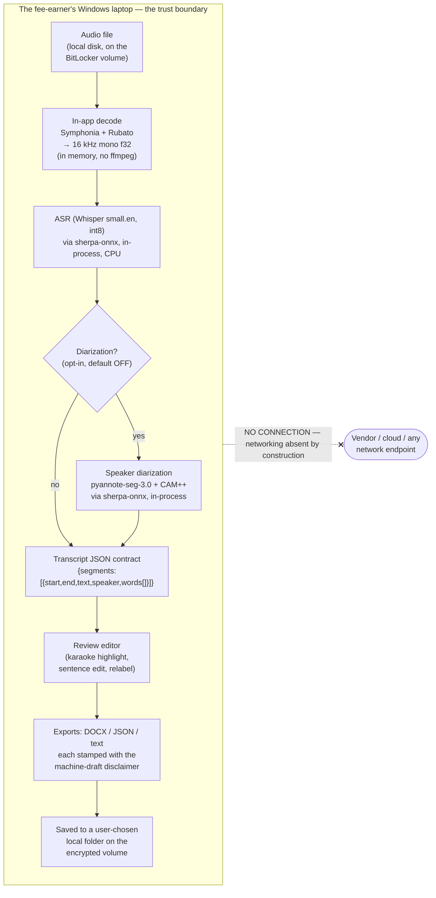

# Data-flow description

> Part of the assurance pack. Addresses PRD user story #23 (DPO wants a
> data-flow diagram + "data never leaves the device" statement).

## Summary

All processing of audio and all derived data (transcript, speaker labels,
exports) happens **on the fee-earner's device**. **Nothing is transmitted to
the vendor or to any third party.** There is no telemetry, no crash reporting,
no analytics, no update ping, and no cloud feature. The application makes
**zero outbound network connections** — see `airplane-mode-verification.md` for
how to confirm this independently.

## The data flow, end to end



Equivalent ASCII view:

```
 audio file                                                      exports
 (local, on        decode        ASR        (opt) diarize       (DOCX/JSON/
  BitLocker)  -->  in-memory --> Whisper --> sherpa-onnx     --> text, with
      |            Symphonia     small.en    pyannote+CAM++       draft notice)
      |            + Rubato      int8 CPU    in-process               |
      |                                                              v
      |                          all in-process, CPU-only      saved locally
      |                          on THIS device                on the encrypted
      |                                                         volume
      +------------------------------------------------------------+
                                |
        =========================================================
        ||  TRUST BOUNDARY = the device. Nothing crosses it.   ||
        ||  No HTTP client linked. CSP connect-src 'none'.     ||
        =========================================================
                                |  (X)  no connection — by construction
                                v
                    vendor / cloud / any endpoint
```

## Stage-by-stage

1. **Audio input.** The user opens a local audio file via the OS file picker
   (`tauri-plugin-dialog`, scoped). The file is read from local disk only.
   ✅ implemented.
2. **Decode.** The file is decoded to 16 kHz mono in-process with the
   pure-Rust `symphonia` (demux/decode) + `rubato` (resample) crates — **no
   bundled ffmpeg, no sidecar, no network**. Decoded samples are held in
   memory (`engine/src/decode.rs`). ✅ implemented.
3. **ASR.** Whisper `small.en` (int8) runs in-process on CPU via the official
   k2-fsa `sherpa-onnx` crate, chunked by Silero VAD (`engine/src/sherpa.rs`).
   ✅ implemented.
4. **Diarization (opt-in, default OFF).** When the user opts in, speaker
   diarization runs in-process (pyannote-segmentation-3.0 ONNX + 3D-Speaker
   CAM++ embedding via `sherpa-onnx`). The default flow produces plain
   pause-based paragraphs with no speaker labels. ✅ implemented.
5. **Transcript assembly + review.** The engine emits the JSON transcript
   contract; the review editor renders it for karaoke playback, sentence-level
   correction, and speaker relabelling. ✅ implemented (`core/`, `app/src`).
6. **Export.** The user exports DOCX, JSON, or plain text to a folder of their
   choosing. Each export carries the machine-generated-draft disclaimer
   (`app/src/draft.ts`, `app/src/docx.ts`). DOCX is built in-process by the
   `docx` npm package — no network. ✅ implemented.

At **no** stage is any byte sent off the device.

## Where the data lives

- **Input audio**: wherever the user already keeps it (read in place).
- **Working data**: held in memory during a transcription run. The current
  engine decodes audio in memory and does not write a separate scratch/temp
  file to disk (`engine/src/decode.rs`); see `data-at-rest.md` for the honest
  status of the PRD's "wipe temp files on completion" intent.
- **Saved transcripts**: each transcript is auto-saved to a local library
  (`app_data/library/`, on the BitLocker volume) so past matters reopen — it
  stores the transcript/edits + a path reference to the source audio (the audio
  is not copied). It never leaves the device; one-click delete-matter purges it.
  See `data-at-rest.md`.
- **Models**: at transcription time, weights are loaded **ONLY from a
  cryptographically verified signed pack** (ed25519 + sha256, fail-closed),
  extracted into a per-user content-addressed cache. Release/hardened builds
  always enforce this; a debug-only `KINDTECH_MODELS_DIR` override exists for the
  dev/demo. See `app/src-tauri/src/commands.rs`, `models.rs`. 🚧 Installer
  bundling of a default signed pack + the production signing key remain roadmap.
- **Exports**: a local folder the user picks, expected to be on the firm's
  **BitLocker-encrypted** volume (see `data-at-rest.md`).

All of these are on the firm's own managed, encrypted Windows laptop. The
vendor has no copy and no access.

## Categories of data involved

The audio can contain **special-category and privileged personal data** (client
interviews, dictation, meetings). The transcript and speaker labels are derived
personal data. Because none of it leaves the device, the recipient set for this
processing is **only the firm itself** — there is no third-party recipient and
no international transfer. See `non-processor-statement.md`.
